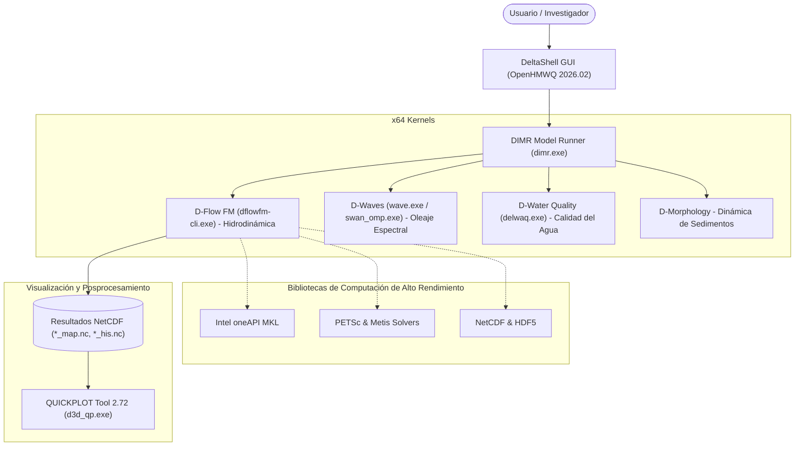

# 🌊 Delft3D Flexible Mesh Suite (2026.02) — Instalador Comunitario para Windows

<p align="center">
  <a href="README.md">English</a> •
  <a href="README.id.md">Bahasa Indonesia</a> •
  <a href="README.nl.md">Nederlands</a> •
  <b>Español</b> •
  <a href="README.fr.md">Français</a> •
  <a href="README.zh.md">中文</a>
</p>

[](https://www.gnu.org/licenses/gpl-3.0)
[]()
[](https://github.com/Deltares/Delft3D)
[](https://drive.google.com/drive/folders/1n4nYRUO1JAszAicliTmhP5IbFDc4uOIP?usp=sharing)
[](../../releases)
[](CITATION.cff)

> **⚠️ Descargo de Responsabilidad y Atribución de Derechos de Autor:**  
> Este repositorio es un proyecto comunitario independiente (*Unofficial Community Packaging & Distribution*) creado para facilitar a estudiantes, investigadores e ingenieros hidráulicos y costeros la instalación de **Delft3D Flexible Mesh Suite** en entornos Windows sin necesidad de compilación manual.  
> Todo el código fuente, los motores de cálculo numérico (*kernels*) y la interfaz gráfica *DeltaShell GUI* son propiedad intelectual de **[Stichting Deltares](https://www.deltares.nl/)**, Delft, Países Bajos. Este proyecto **no está oficialmente afiliado ni respaldado por Deltares** y se distribuye cumpliendo estrictamente con los términos de las licencias oficiales de código abierto de Deltares.

---

## 🏗️ Resumen de la Arquitectura Integrada



---

## 🚀 Descarga e Instalación

### 1. Descarga del Instalador

Puede descargar el paquete de instalación ejecutable directamente a través del enlace de Google Drive (sin necesidad de compilar código fuente):

| Fuente de Descarga | Enlace | Tamaño | Descripción |
| :--- | :---: | :---: | :--- |
| 🚀 **Google Drive (Recomendado)** | [**Descargar vía Google Drive**](https://drive.google.com/drive/folders/1n4nYRUO1JAszAicliTmhP5IbFDc4uOIP?usp=sharing) | `703.4 MB` | Descarga directa de alta velocidad, listo para usar |
| 📦 **GitHub Releases** | [**Descargar vía GitHub Releases**](../../releases) | `703.4 MB` | Enlace alternativo en el repositorio |

> **Detalles del Archivo:**
> * **Nombre**: `Delft3D_FM_Suite_2026.02_AllInOne_Setup.exe`
> * **Tamaño**: ~703.4 MB (737.618.133 bytes)
> * **Checksum (SHA256)**: `56BCF9F3D873CF774752C0E9E7A880EF90DB5BBC4484C43FA8D5F6EAD0D04235`
> * *(La carpeta de Google Drive también contiene el instalador auxiliar `vc_redist.x64.exe` de Microsoft).*

---

## 🔑 Cómo Obtener una Licencia Oficial Gratuita de Deltares

Por motivos de privacidad, este instalador **NO incluye archivos de licencia personales**. Puede obtener su licencia oficial gratuita (**€ 0.00**) directamente del portal oficial de Deltares en 2 minutos:

1. Visite: [Deltares Delft3D FM Open Source GUI](https://download.deltares.nl/delft3d-fm-suite-2d3d-graphical-user-interface-gui-open-source).
2. Añada el producto a su cesta (**€ 0.00 / Gratis**) y proceda al pago (*Checkout*).
3. Ingrese sus datos (nombre, institución/universidad y correo electrónico) y confirme la solicitud.
4. Recibirá un correo de Deltares con el archivo de licencia `.lic` adjunto.
5. Durante la instalación, seleccione el archivo descargado o cópielo a `C:\Program Files (x86)\DS_Flex\`.

---

## 📖 Citación Científica

Si utiliza este software en sus investigaciones académicas o proyectos de ingeniería, por favor cite a Deltares:

```bibtex
@manual{DeltaresDelft3DFM2026,
  author       = {{Deltares}},
  title        = {{Delft3D Flexible Mesh Suite: 1D-2D-3D Integrated Hydrodynamic, Wave, Water Quality and Morphology Modelling System}},
  organization = {Stichting Deltares},
  address      = {Delft, The Netherlands},
  year         = {2026},
  url          = {https://www.deltares.nl/en/software-and-data/products/delft3d-flexible-mesh-suite}
}
```

---

## ⚖️ Licencia

* Motores de cálculo: **GPL-3.0** / **AGPL-3.0** (Stichting Deltares).
* Interfaz gráfica (GUI): *Deltares Open Source Software License Agreement*.
* Scripts de empaquetado: **Licencia MIT**.
