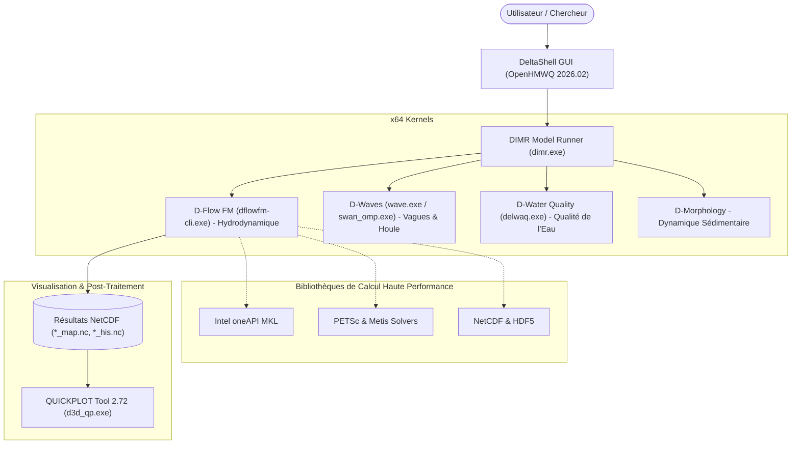

# 🌊 Delft3D Flexible Mesh Suite (2026.02) — Installateur Communautaire pour Windows

<p align="center">
  <a href="README.md">English</a> •
  <a href="README.id.md">Bahasa Indonesia</a> •
  <a href="README.nl.md">Nederlands</a> •
  <a href="README.es.md">Español</a> •
  <b>Français</b> •
  <a href="README.zh.md">中文</a>
</p>

[](https://www.gnu.org/licenses/gpl-3.0)
[]()
[](https://github.com/Deltares/Delft3D)
[](https://drive.google.com/drive/folders/1n4nYRUO1JAszAicliTmhP5IbFDc4uOIP?usp=sharing)
[](../../releases)
[](CITATION.cff)

> **⚠️ Avertissement Légal & Attribution des Droits d'Auteur :**  
> Ce dépôt est un projet communautaire indépendant (*Unofficial Community Packaging & Distribution*) créé pour aider les étudiants, chercheurs et ingénieurs hydrauliciens à installer facilement la **Delft3D Flexible Mesh Suite** sur Windows sans compilation manuelle complexe.  
> L'ensemble du code source, les moteurs de calcul numérique (*kernels*) et l'interface *DeltaShell GUI* sont développés par et sont la propriété intellectuelle de **[Stichting Deltares](https://www.deltares.nl/)**, Delft, Pays-Bas. Ce projet **n'est pas officiellement affilié à ou approuvé par Deltares** et fonctionne en stricte conformité avec les licences open source de Deltares.

---

## 🏗️ Architecture Intégrée



---

## 🚀 Téléchargement & Installation

### 1. Télécharger l'Installateur Exécutable

Vous pouvez télécharger le fichier d'installation prêt à l'emploi via le lien Google Drive ci-dessous (sans aucune compilation requise) :

| Source | Lien de Téléchargement | Taille | Description |
| :--- | :---: | :---: | :--- |
| 🚀 **Google Drive (Recommandé)** | [**Télécharger via Google Drive**](https://drive.google.com/drive/folders/1n4nYRUO1JAszAicliTmhP5IbFDc4uOIP?usp=sharing) | `703.4 Mo` | Téléchargement direct rapide, prêt à l'emploi |
| 📦 **GitHub Releases** | [**Télécharger via GitHub Releases**](../../releases) | `703.4 Mo` | Miroir binaire officiel du dépôt |

> **Détails du Fichier :**
> * **Nom du Fichier** : `Delft3D_FM_Suite_2026.02_AllInOne_Setup.exe`
> * **Taille** : ~703.4 Mo (737 618 133 octets)
> * **Empreinte SHA256** : `56BCF9F3D873CF774752C0E9E7A880EF90DB5BBC4484C43FA8D5F6EAD0D04235`
> * *(Le dossier Google Drive contient également le paquet Microsoft `vc_redist.x64.exe` si nécessaire).*

---

## 🔑 Obtenir une Licence Officielle Gratuite de Deltares

Pour des raisons de confidentialité, cet installateur **ne contient aucun fichier de licence personnel**. Vous pouvez obtenir votre licence officielle gratuite (**€ 0.00**) directement sur le portail de Deltares en 2 minutes :

1. Visitez : [Deltares Delft3D FM Open Source GUI Download](https://download.deltares.nl/delft3d-fm-suite-2d3d-graphical-user-interface-gui-open-source).
2. Ajoutez le produit à votre panier (**€ 0.00 / Gratuit**) et validez votre commande.
3. Renseignez vos informations (nom, établissement/université et adresse email) et confirmez.
4. Téléchargez le fichier de licence `.lic` reçu dans le courriel de confirmation de Deltares.
5. Sélectionnez ce fichier lors de l'installation ou copiez-le dans `C:\Program Files (x86)\DS_Flex\`.

---

## 📖 Citations Académiques

Si vous utilisez ce logiciel dans vos recherches académiques ou projets d'ingénierie, veuillez citer Deltares :

```bibtex
@manual{DeltaresDelft3DFM2026,
  author       = {{Deltares}},
  title        = {{Delft3D Flexible Mesh Suite: 1D-2D-3D Integrated Hydrodynamic, Wave, Water Quality and Morphology Modelling System}},
  organization = {Stichting Deltares},
  address      = {Delft, The Netherlands},
  year         = {2026},
  url          = {https://www.deltares.nl/en/software-and-data/products/delft3d-flexible-mesh-suite}
}
```

---

## ⚖️ Licence

* Moteurs de calcul numérique : **GPL-3.0** / **AGPL-3.0** (Stichting Deltares).
* Interface graphique (GUI) : *Deltares Open Source Software License Agreement*.
* Scripts d'installation du dépôt : **Licence MIT**.
