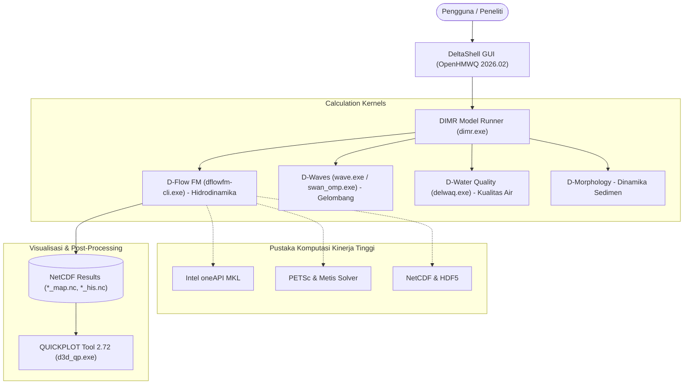

# 🌊 Delft3D Flexible Mesh Suite (2026.02) — Community Windows Installer

<p align="center">
  <a href="README.md">English</a> •
  <b>Bahasa Indonesia</b> •
  <a href="README.nl.md">Nederlands</a> •
  <a href="README.es.md">Español</a> •
  <a href="README.fr.md">Français</a> •
  <a href="README.zh.md">中文</a>
</p>

[](https://www.gnu.org/licenses/gpl-3.0)
[]()
[](https://github.com/Deltares/Delft3D)
[](https://drive.google.com/drive/folders/1n4nYRUO1JAszAicliTmhP5IbFDc4uOIP?usp=sharing)
[](../../releases)
[](CITATION.cff)

> **⚠️ Disclaimer & Atribusi Hak Cipta:**  
> Repositori ini adalah proyek pengemasan komunitas independen (*Unofficial Community Packaging & Distribution*) yang bertujuan mempermudah mahasiswa, peneliti, perekayasa, dan praktisi dalam memasang **Delft3D Flexible Mesh Suite** di lingkungan Windows secara instan.  
> Seluruh kode sumber, mesin kalkulasi (*calculation kernels*), dan antarmuka *DeltaShell GUI* dikembangkan dan merupakan hak cipta milik **[Stichting Deltares](https://www.deltares.nl/)**, Delft, Belanda. Proyek ini **tidak berafiliasi secara komersial maupun didukung secara resmi oleh Deltares**, melainkan dibangun berdasarkan pedoman dan ketentuan lisensi sumber terbuka (*Open Source*) resmi Deltares.

---

## 🏗️ Arsitektur Paket Terintegrasi

Diagram di bawah ini mengilustrasikan bagaimana antarmuka grafis, model runner, mesin numerik, dan alat analisis terhubung dalam paket ini:



---

## 📚 Navigasi Dokumentasi Lengkap

Seluruh panduan teknis dan tutorial terperinci telah disediakan di dalam folder [`docs/`](docs/):

| Dokumen | Deskripsi |
| :--- | :--- |
| 📖 [**Panduan Instalasi**](docs/PANDUAN_INSTALASI.md) | Panduan langkah demi langkah menjalankan file installer mandiri |
| 🔑 [**Panduan Lisensi Resmi Deltares**](docs/PANDUAN_LISENSI_DELTARES.md) | Cara mendapatkan lisensi gratis (€ 0.00) resmi langsung dari portal Deltares |
| 🛠️ [**Troubleshooting & FAQ**](docs/TROUBLESHOOTING.md) | Solusi masalah umum (Visual C++, SmartScreen, registry FlexNet) |
| ⚙️ [**Panduan Kompilasi Source Code**](docs/PANDUAN_KOMPILASI_SOURCE.md) | Panduan teknis kompilasi kode sumber Delft3D FM dari hulu (*upstream*) |
| 🛡️ [**Kebijakan Privasi & Keamanan**](SECURITY.md) | Jaminan perlindungan privasi data pribadi pengguna |

---

## 📦 Apa Saja yang Ada di Dalam Paket Installer Ini?

Installer mandiri mengemas seluruh ekosistem Delft3D Flexible Mesh Suite ke dalam 1 berkas `.exe` tunggal:

1. **DeltaShell Graphical User Interface (OpenHMWQ 2026.02)**: GUI resmi untuk mempermudah pembuatan grid, konfigurasi batas wilayah (*boundary conditions*), parameterisasi, dan kontrol simulasi 1D, 2D, serta 3D.
2. **Mesin Kalkulasi Lengkap (Kernels x64)**:
   * **D-Flow FM**: Solver hidrodinamika jaring tak terstruktur (*unstructured mesh*).
   * **D-Waves (SWAN)**: Solver propagasi spektral gelombang laut dan pantai.
   * **D-Water Quality (DELWAQ)**: Solver transpor polutan, dispersi, dan kualitas perairan.
   * **D-Morphology**: Solver dinamika sedimen dan perubahan batimetri dasar air.
   * Didukung pustaka komputasi performa tinggi: **Intel MKL**, **PETSc**, **NetCDF**, **HDF5**, dan **OpenMP**.
3. **QUICKPLOT Tool 2.72 (64-bit)**: Perangkat visualisasi data simulasi (kontur, kurva time-series, vektor arus, dan penampang melintang).
4. **Kumpulan Tutorial & Kasus Studi Resmi**: Contoh model siap uji dari Deltares (estuari Scheldt, muara, dan sungai).
5. **Konfigurasi Lingkungan FlexNet Otomatis**: Mempersiapkan registry dan folder lisensi `C:\Program Files (x86)\DS_Flex` secara otomatis saat instalasi.

---

## 🔒 Perlindungan Privasi & Keamanan Data Pengguna

> [!IMPORTANT]
> Untuk menjaga privasi pengguna, paket installer ini **TIDAK menyertakan data atau file lisensi pribadi siapapun**. Setiap pengguna diarahkan untuk memperoleh file lisensi resmi gratis (€ 0.00) atas nama pribadi/kampus langsung dari Deltares (proses hanya butuh waktu 2 menit).

### Cara Cepat Mendapatkan Lisensi Resmi Deltares:
1. Kunjungi portal resmi: [Deltares Delft3D FM Open Source GUI Download](https://download.deltares.nl/delft3d-fm-suite-2d3d-graphical-user-interface-gui-open-source).
2. Klik **"Order"** / **"Add to Cart"** (Biaya: **€ 0.00 / Gratis**), lalu lanjutkan ke **Checkout**.
3. Isi data nama, lembaga/universitas, dan email aktif Anda, lalu klik **Submit Order**.
4. Buka email Anda, unduh berkas lampiran lisensi `.lic` (misalnya: `Delft3D_FM_2D3D_GUI_OSS.lic`).  
*(Lihat panduan lengkap bergambar di [docs/PANDUAN_LISENSI_DELTARES.md](docs/PANDUAN_LISENSI_DELTARES.md))*.

---

## 🚀 Unduhan & Instalasi

### 1. Unduh Berkas Installer

Anda dapat mengunduh paket installer siap pakai secara langsung melalui tautan cloud Google Drive di bawah ini (tanpa perlu proses kompilasi kode sumber):

| Sumber Unduhan | Tautan Unduh | Ukuran | Keterangan |
| :--- | :---: | :---: | :--- |
| 🚀 **Google Drive (Sangat Disarankan)** | [**Unduh Installer via Google Drive**](https://drive.google.com/drive/folders/1n4nYRUO1JAszAicliTmhP5IbFDc4uOIP?usp=sharing) | `703.4 MB` | Unduhan langsung berkecepatan tinggi, bebas kompilasi |
| 📦 **GitHub Releases** | [**Unduh via GitHub Releases**](../../releases) | `703.4 MB` | Mirror unduhan resmi di repositori GitHub |

> **Detail Berkas Installer:**
> * **Nama Berkas**: `Delft3D_FM_Suite_2026.02_AllInOne_Setup.exe`
> * **Ukuran**: ~703.4 MB (737,618,133 bytes)
> * **Checksum (SHA256)**: `56BCF9F3D873CF774752C0E9E7A880EF90DB5BBC4484C43FA8D5F6EAD0D04235`
> * *(Catatan: Di dalam folder Google Drive tersebut juga telah disediakan file cadangan `vc_redist.x64.exe` jika komputer Anda belum memiliki runtime C++ Microsoft).*

### 2. Jalankan Wizard Instalasi
1. Klik kanan pada file installer, pilih **Run as administrator**.
2. Pilih komponen yang ingin dipasang (Core GUI & Kernels, QuickPlot, Tutorials).
3. **Konfigurasi Lisensi:**
   * **Opsi 1 (Direkomendasikan):** Pilih *"Pilih file lisensi (.lic) resmi yang sudah saya peroleh dari Deltares"* -> Klik tombol **Browse** dan arahkan ke file `.lic` yang Anda unduh dari email Deltares. Installer akan otomatis memasang dan meregistrasikannya ke sistem!
   * **Opsi 2:** Pilih *"Lewati"* jika ingin menyalin lisensi secara manual ke `C:\Program Files (x86)\DS_Flex\` nanti.
4. Klik **Install** dan aplikasi langsung siap digunakan dari shortcut Desktop atau Start Menu!

---

## 🔗 Tautan Resmi Deltares (Upstream Links)

Untuk informasi resmi, kode sumber hulu (*upstream*), dan komunitas pengembang resmi:
* 🌐 **Situs Resmi Deltares**: [https://www.deltares.nl/](https://www.deltares.nl/)
* 💻 **Repositori Kode Sumber Asli**: [https://github.com/Deltares/Delft3D](https://github.com/Deltares/Delft3D)
* 📥 **Portal Unduhan & Lisensi Resmi Deltares**: [https://download.deltares.nl/](https://download.deltares.nl/)
* 📚 **Dokumentasi & Manual Resmi Delft3D FM**: [https://oss.deltares.nl/web/delft3dfm](https://oss.deltares.nl/web/delft3dfm)
* 💬 **Forum Diskusi Komunitas Resmi**: [Deltares GitHub Discussions](https://github.com/Deltares/Delft3D/discussions)

---

## 📖 Sitasi Ilmiah (Citations)

Jika Anda menggunakan software ini untuk penelitian ilmiah, penulisan skripsi/tesis, publikasi jurnal, atau laporan proyek rekayasa, **Anda wajib mengutip Deltares dan publikasi ilmiah Delft3D Flexible Mesh** sebagai bentuk etika akademik dan penghargaan hak cipta:

### Format APA:
> Deltares. (2026). *Delft3D Flexible Mesh Suite: Hydrodynamics, Waves, Water Quality and Morphology Simulation System*. Stichting Deltares, Delft, The Netherlands. https://www.deltares.nl/en/software-and-data/products/delft3d-flexible-mesh-suite

### Format BibTeX:
```bibtex
@manual{DeltaresDelft3DFM2026,
  author       = {{Deltares}},
  title        = {{Delft3D Flexible Mesh Suite: 1D-2D-3D Integrated Hydrodynamic, Wave, Water Quality and Morphology Modelling System}},
  organization = {Stichting Deltares},
  address      = {Delft, The Netherlands},
  year         = {2026},
  url          = {https://www.deltares.nl/en/software-and-data/products/delft3d-flexible-mesh-suite}
}

@article{kernkamp2011efficient,
  title        = {Efficient grid generation on unstructured meshes for shallow water flow modelling},
  author       = {Kernkamp, H. W. J. and Van Dam, A. and Stelling, G. S. and de Goede, E. D.},
  journal      = {Ocean Dynamics},
  volume       = {61},
  number       = {8},
  pages        = {1175--1188},
  year         = {2011},
  publisher    = {Springer}
}
```

---

## ⚖️ Lisensi (License)

* Kode sumber solver dan kernel komputasi didistribusikan di bawah lisensi **GNU General Public License v3.0 (GPLv3)** dan **GNU Affero General Public License v3.0 (AGPLv3)** oleh Stichting Deltares.
* Komponen GUI didistribusikan sesuai dengan perjanjian lisensi komunitas *Deltares Open Source Software License*.
* Paket skrip installer dalam repositori ini dirilis di bawah lisensi **MIT License** untuk kebebasan komunitas. Lihat berkas [LICENSE](LICENSE) untuk informasi lebih lanjut.

---
*Proyek ini dirawat oleh komunitas pengguna Delft3D Indonesia untuk memajukan riset kelautan, hidrologi, dan teknik pantai nasional.*
