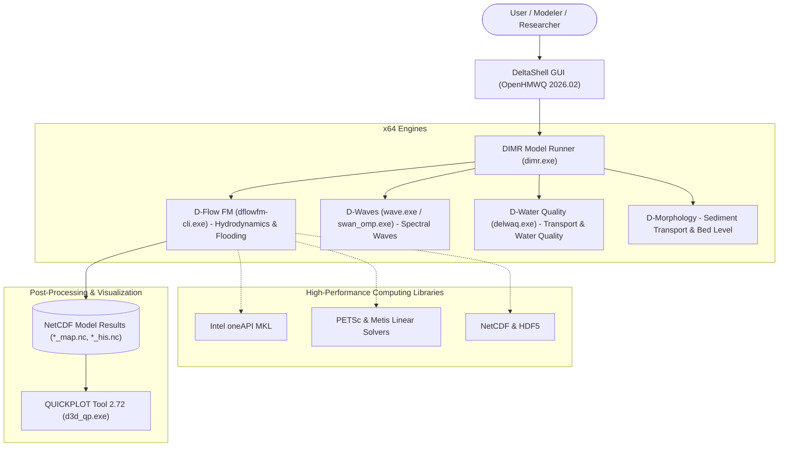

# 🌊 Delft3D Flexible Mesh Suite (2026.02) — Community Windows Installer

<p align="center">
  <b>English</b> •
  <a href="README.id.md">Bahasa Indonesia</a> •
  <a href="README.nl.md">Nederlands</a> •
  <a href="README.es.md">Español</a> •
  <a href="README.fr.md">Français</a> •
  <a href="README.zh.md">中文</a>
</p>

[](https://www.gnu.org/licenses/gpl-3.0)
[]()
[](https://github.com/Deltares/Delft3D)
[](https://drive.google.com/drive/folders/1n4nYRUO1JAszAicliTmhP5IbFDc4uOIP?usp=sharing)
[](../../releases)
[](CITATION.cff)

> **⚠️ Legal Disclaimer & Copyright Attribution:**  
> This repository is an independent community project (*Unofficial Community Packaging & Distribution*) created to assist students, researchers, hydraulic engineers, and coastal modelers with installing the **Delft3D Flexible Mesh Suite** on Windows systems instantly without complex manual compilation.  
> All source code, simulation engines (*kernels*), and the *DeltaShell Graphical User Interface* are developed by and are the copyrighted property of **[Stichting Deltares](https://www.deltares.nl/)**, Delft, The Netherlands. This project is **not officially affiliated with or endorsed by Deltares**, and is provided strictly in adherence with Deltares' official Open Source licensing terms and integration guidelines.

---

## 🏗️ Integrated Architecture Overview

The diagram below illustrates how the graphical environment, model runner, numerical solvers, and post-processing visualization utilities communicate within this packaged distribution:



---

## 📚 Documentation & Technical Guides

Comprehensive setup guides and technical workflows are available in the [`docs/`](docs/) directory:

| Document | Description |
| :--- | :--- |
| 📖 [**Installation Guide**](docs/PANDUAN_INSTALASI.md) | Step-by-step walkthrough to run the standalone installer |
| 🔑 [**Official Deltares License Guide**](docs/PANDUAN_LISENSI_DELTARES.md) | How to obtain a 100% free (**€ 0.00**) official license file directly from Deltares |
| 🛠️ [**Troubleshooting & FAQ**](docs/TROUBLESHOOTING.md) | Solutions for common hurdles (Visual C++ runtime, SmartScreen, FlexNet registry) |
| ⚙️ [**Source Code Compilation Guide**](docs/PANDUAN_KOMPILASI_SOURCE.md) | Complete guide for building calculation kernels from upstream source code |
| 🛡️ [**Privacy & Security Policy**](SECURITY.md) | Guarantee regarding privacy, zero telemetry, and exclusion of private credentials |

---

## 📦 What Is Included in This All-in-One Package?

This standalone setup executable bundles the complete Delft3D Flexible Mesh modeling ecosystem into a single installer:

1. **DeltaShell Graphical User Interface (OpenHMWQ 2026.02)**: The official Deltares GUI for model configuration, grid inspection, boundary specification, and 1D/2D/3D numerical control.
2. **Complete 64-bit Numerical Engines (Kernels)**:
   * **D-Flow FM**: Unstructured mesh hydrodynamic solver for rivers, estuaries, and coastal waters.
   * **D-Waves (SWAN)**: Spectral wind-wave propagation and transformation solver.
   * **D-Water Quality (DELWAQ)**: Multi-dimensional water quality, pollutant dispersion, and biochemical kinetics.
   * **D-Morphology**: Bedload and suspended sediment transport with morphodynamic feedback.
   * High-Performance Computing runtimes: **Intel MKL**, **PETSc**, **NetCDF**, **HDF5**, and **OpenMP**.
3. **QUICKPLOT Tool 2.72 (Windows 64-bit)**: Specialized visual post-processor for netCDF output curves, profiles, vector currents, and contour maps.
4. **Official Deltares Case Studies & Tutorials**: Verified test models and data sets (Scheldt estuary, wave flumes, etc.).
5. **Automated Licensing Environment**: Automatically prepares the FlexNet search directory (`C:\Program Files (x86)\DS_Flex`) and registry entries.

---

## 🔒 Privacy & User Data Protection

> [!IMPORTANT]
> To protect individual privacy, this installer package **DOES NOT bundle any personal license files**. Every user is guided to obtain their own official, 100% free (**€ 0.00**) license file directly from the Deltares portal under their own identity (takes approximately 2 minutes).

### How to Get Your Free Official Deltares License:
1. Visit the official download portal: [Deltares Delft3D FM Open Source GUI](https://download.deltares.nl/delft3d-fm-suite-2d3d-graphical-user-interface-gui-open-source).
2. Click **"Order"** / **"Add to Cart"** (Cost: **€ 0.00 / Free of Charge**), then proceed to **Checkout**.
3. Fill in your name, university/organization, and email address, then click **Submit Order**.
4. Check your email inbox and download your `.lic` license file (e.g. `Delft3D_FM_2D3D_GUI_OSS.lic`).  
*(For detailed instructions, see [docs/PANDUAN_LISENSI_DELTARES.md](docs/PANDUAN_LISENSI_DELTARES.md))*.

---

## 🚀 Download & Installation

### 1. Download the Installer Executable

You can download the ready-to-use setup executable directly from the cloud link below without any source code compilation:

| Download Source | Download Link | File Size | Description |
| :--- | :---: | :---: | :--- |
| 🚀 **Google Drive (Recommended)** | [**Download via Google Drive**](https://drive.google.com/drive/folders/1n4nYRUO1JAszAicliTmhP5IbFDc4uOIP?usp=sharing) | `703.4 MB` | High-speed direct cloud mirror, precompiled and ready |
| 📦 **GitHub Releases** | [**Download via GitHub Releases**](../../releases) | `703.4 MB` | Official repository binary release mirror |

> **Installer Details:**
> * **Filename**: `Delft3D_FM_Suite_2026.02_AllInOne_Setup.exe`
> * **File Size**: ~703.4 MB (737,618,133 bytes)
> * **Integrity Checksum (SHA256)**: `56BCF9F3D873CF774752C0E9E7A880EF90DB5BBC4484C43FA8D5F6EAD0D04235`
> * *(Note: The Google Drive folder also contains the optional `vc_redist.x64.exe` Microsoft runtime installer if needed).*

### 2. Run the Setup Wizard
1. Right-click `Delft3D_FM_Suite_2026.02_AllInOne_Setup.exe`, select **Run as administrator**.
2. Select desired components (Core GUI & Kernels, QUICKPLOT, Tutorials).
3. **License Configuration:**
   * **Option 1 (Recommended):** Choose *"Select official license file (.lic) obtained from Deltares"* -> Click **Browse** -> Select the `.lic` file downloaded from Deltares. The installer will automatically place and configure it.
   * **Option 2:** Choose *"Skip"* if you prefer to copy your license to `C:\Program Files (x86)\DS_Flex\` manually later.
4. Click **Install**. Launch Delft3D FM directly from your Desktop or Start Menu!

---

## 🔗 Official Deltares Links (Upstream)

For official documentation, upstream source code, and community discussions:
* 🌐 **Official Deltares Website**: [https://www.deltares.nl/](https://www.deltares.nl/)
* 💻 **Official Source Code Repository**: [https://github.com/Deltares/Delft3D](https://github.com/Deltares/Delft3D)
* 📥 **Deltares Software Download & Licensing Portal**: [https://download.deltares.nl/](https://download.deltares.nl/)
* 📚 **Delft3D FM Official Documentation & Manuals**: [https://oss.deltares.nl/web/delft3dfm](https://oss.deltares.nl/web/delft3dfm)
* 💬 **Deltares GitHub Community Discussions**: [Deltares GitHub Discussions](https://github.com/Deltares/Delft3D/discussions)

---

## 📖 Academic Citations

If you use this community distribution or Delft3D Flexible Mesh in your academic research, thesis, dissertation, journal publication, or consulting project, **please properly cite Deltares and foundational Delft3D scientific publications**:

### APA Format:
> Deltares. (2026). *Delft3D Flexible Mesh Suite: Hydrodynamics, Waves, Water Quality and Morphology Simulation System*. Stichting Deltares, Delft, The Netherlands. https://www.deltares.nl/en/software-and-data/products/delft3d-flexible-mesh-suite

### BibTeX Format:
```bibtex
@manual{DeltaresDelft3DFM2026,
  author       = {{Deltares}},
  title        = {{Delft3D Flexible Mesh Suite: 1D-2D-3D Integrated Hydrodynamic, Wave, Water Quality and Morphology Modelling System}},
  organization = {Stichting Deltares},
  address      = {Delft, The Netherlands},
  year         = {2026},
  url          = {https://www.deltares.nl/en/software-and-data/products/delft3d-flexible-mesh-suite}
}

@article{kernkamp2011efficient,
  title        = {Efficient grid generation on unstructured meshes for shallow water flow modelling},
  author       = {Kernkamp, H. W. J. and Van Dam, A. and Stelling, G. S. and de Goede, E. D.},
  journal      = {Ocean Dynamics},
  volume       = {61},
  number       = {8},
  pages        = {1175--1188},
  year         = {2011},
  publisher    = {Springer}
}
```

---

## ⚖️ License

* The numerical simulation engines and solvers are distributed under the **GNU General Public License v3.0 (GPLv3)** and **GNU Affero General Public License v3.0 (AGPLv3)** by Stichting Deltares.
* The graphical interface (GUI) is distributed under the terms of the *Deltares Open Source Software License Agreement*.
* Packaging scripts and installer definitions in this repository are licensed under the **MIT License**. See [LICENSE](LICENSE) for details.

---
*Maintained by the Delft3D Community to facilitate open scientific research and engineering practice worldwide.*
