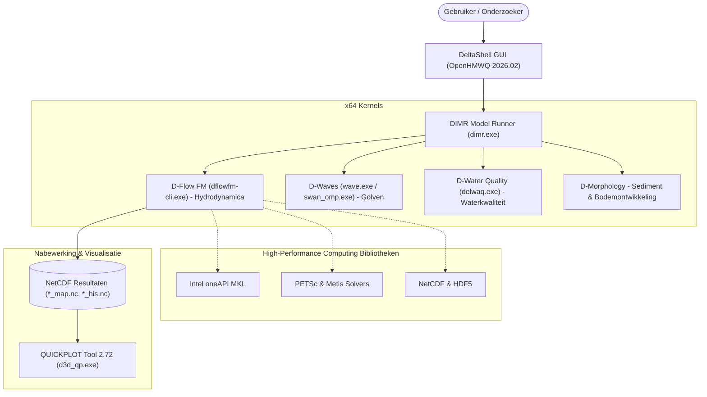

# 🌊 Delft3D Flexible Mesh Suite (2026.02) — Community Windows Installer

<p align="center">
  <a href="README.md">English</a> •
  <a href="README.id.md">Bahasa Indonesia</a> •
  <b>Nederlands</b> •
  <a href="README.es.md">Español</a> •
  <a href="README.fr.md">Français</a> •
  <a href="README.zh.md">中文</a>
</p>

[](https://www.gnu.org/licenses/gpl-3.0)
[]()
[](https://github.com/Deltares/Delft3D)
[](https://drive.google.com/drive/folders/1n4nYRUO1JAszAicliTmhP5IbFDc4uOIP?usp=sharing)
[](../../releases)
[](CITATION.cff)

> **⚠️ Juridische Disclaimer & Auteursrechtvermelding:**  
> Deze repository is een onafhankelijk gemeenschapsproject (*Unofficial Community Packaging & Distribution*) met als doel studenten, onderzoekers en waterbouwkundigen te helpen bij het eenvoudig installeren van de **Delft3D Flexible Mesh Suite** op Windows.  
> Alle broncode, rekenschillen (*calculation kernels*) en de *DeltaShell GUI* zijn ontwikkeld door en zijn het intellectuele eigendom van **[Stichting Deltares](https://www.deltares.nl/)**, Delft, Nederland. Dit project is **niet officieel verbonden aan of goedgekeurd door Deltares** en functioneert strikt volgens de officiële open-sourcelicenties van Deltares.

---

## 🏗️ Overzicht van de Geïntegreerde Architectuur



---

## 🚀 Download & Installatie

### 1. Download het Installatiebestand

U kunt het kant-en-klare installatiepakket rechtstreeks downloaden via onderstaande Google Drive-link (geen handmatige broncodecompilatie nodig):

| Downloadbron | Downloadlink | Bestandsgrootte | Omschrijving |
| :--- | :---: | :---: | :--- |
| 🚀 **Google Drive (Aanbevolen)** | [**Download via Google Drive**](https://drive.google.com/drive/folders/1n4nYRUO1JAszAicliTmhP5IbFDc4uOIP?usp=sharing) | `703.4 MB` | Snelle directe download, gebruiksklaar |
| 📦 **GitHub Releases** | [**Download via GitHub Releases**](../../releases) | `703.4 MB` | Officiële mirror op GitHub |

> **Bestandsdetails:**
> * **Bestandsnaam**: `Delft3D_FM_Suite_2026.02_AllInOne_Setup.exe`
> * **Grootte**: ~703.4 MB (737.618.133 bytes)
> * **Controlesom (SHA256)**: `56BCF9F3D873CF774752C0E9E7A880EF90DB5BBC4484C43FA8D5F6EAD0D04235`
> * *(De Google Drive-map bevat ook het optionele Microsoft runtime-bestand `vc_redist.x64.exe`)*.

---

## 🔑 Officiële Gratis Deltares Licentie Verkrijgen

Om privacyredenen bevat dit installatiepakket **geen persoonlijke licentiebestanden**. U kunt binnen 2 minuten gratis (**€ 0,00**) uw eigen officiële licentie aanvragen via het officiële Deltares-portaal:

1. Bezoek: [Deltares Delft3D FM Open Source GUI Download](https://download.deltares.nl/delft3d-fm-suite-2d3d-graphical-user-interface-gui-open-source).
2. Voeg het product toe aan uw winkelwagen (**€ 0,00 / Gratis**) en rond de bestelling af.
3. Vul uw naam, instelling/universiteit en e-mailadres in en verzend de aanvraag.
4. Download het licentiebestand (`.lic`) uit de bevestigingsmail van Deltares.
5. Selecteer tijdens de installatie dit bestand of plaats het in `C:\Program Files (x86)\DS_Flex\`.

---

## 📖 Wetenschappelijke Citeringswijze (Citations)

Bij gebruik in onderzoek of publicaties dient Deltares als volgt te worden vermeld:

```bibtex
@manual{DeltaresDelft3DFM2026,
  author       = {{Deltares}},
  title        = {{Delft3D Flexible Mesh Suite: 1D-2D-3D Integrated Hydrodynamic, Wave, Water Quality and Morphology Modelling System}},
  organization = {Stichting Deltares},
  address      = {Delft, The Netherlands},
  year         = {2026},
  url          = {https://www.deltares.nl/en/software-and-data/products/delft3d-flexible-mesh-suite}
}
```

---

## ⚖️ Licentie

* Rekenmodules: **GPL-3.0** / **AGPL-3.0** (Stichting Deltares).
* GUI: *Deltares Open Source Software License*.
* Installatiescripts in deze repository: **MIT License**.
