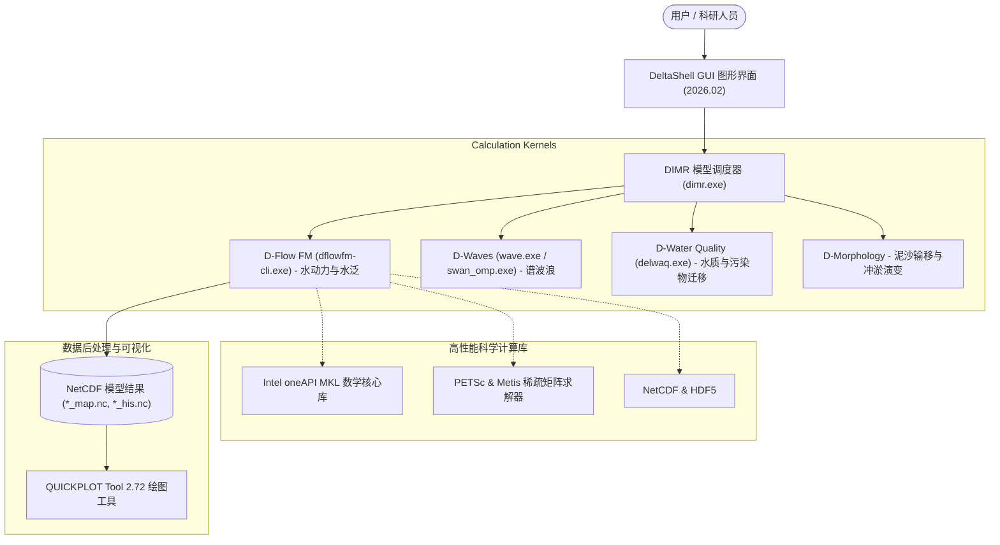

# 🌊 Delft3D Flexible Mesh Suite (2026.02) — 社区版 Windows 独立安装包

<p align="center">
  <a href="README.md">English</a> •
  <a href="README.id.md">Bahasa Indonesia</a> •
  <a href="README.nl.md">Nederlands</a> •
  <a href="README.es.md">Español</a> •
  <a href="README.fr.md">Français</a> •
  <b>中文</b>
</p>

[](https://www.gnu.org/licenses/gpl-3.0)
[]()
[](https://github.com/Deltares/Delft3D)
[](https://drive.google.com/drive/folders/1n4nYRUO1JAszAicliTmhP5IbFDc4uOIP?usp=sharing)
[](../../releases)
[](CITATION.cff)

> **⚠️ 法律声明与版权归属：**  
> 本代码仓库是一个独立的开源社区打包项目（*Unofficial Community Packaging & Distribution*），旨在帮助水利、海岸水运与海洋科研人员、高校师生在 Windows 环境下一键安装并开箱即用 **Delft3D Flexible Mesh Suite**，免去复杂的源代码编译过程。  
> 所有底层数值计算内核、源代码以及 *DeltaShell* 图形界面均由荷兰 **[Stichting Deltares](https://www.deltares.nl/)** 研发并享有完整知识产权。本项目**非 Deltares 官方商业分支**，但在严格遵守 Deltares 官方开源许可协议的前提下提供分发服务。

---

## 🏗️ 架构集成概览



---

## 🚀 下载与安装

### 1. 下载一键安装包

您可以通过下方高速云盘链接直接下载预编译安装程序，无需自行配置编译环境：

| 下载渠道 | 链接 | 大小 | 说明 |
| :--- | :---: | :---: | :--- |
| 🚀 **Google Drive (推荐)** | [**从 Google Drive 下载安装包**](https://drive.google.com/drive/folders/1n4nYRUO1JAszAicliTmhP5IbFDc4uOIP?usp=sharing) | `703.4 MB` | 预编译完整独立安装包，高速下载 |
| 📦 **GitHub Releases** | [**从 GitHub Releases 下载**](../../releases) | `703.4 MB` | 官方代码仓库 Release 镜像 |

> **安装包属性详情：**
> * **文件名**：`Delft3D_FM_Suite_2026.02_AllInOne_Setup.exe`
> * **文件大小**：~703.4 MB (737,618,133 字节)
> * **完整性校验码 (SHA256)**：`56BCF9F3D873CF774752C0E9E7A880EF90DB5BBC4484C43FA8D5F6EAD0D04235`
> * *(注：网盘文件夹内同时备有微软环境支持库 `vc_redist.x64.exe`)*。

### 2. 运行安装向导
1. 鼠标右键以**管理员身份运行** `Delft3D_FM_Suite_2026.02_AllInOne_Setup.exe`。
2. 选择安装组件（GUI 核心、QUICKPLOT 绘图工具、官方教程算例）。
3. **许可证配置：**
   * **选项 1（推荐）：** 选择*“选择从 Deltares 获取的官方许可证文件 (.lic)”* -> 点击 **Browse** 并指定下载的 `.lic` 文件。安装程序将自动配置注册表。
   * **选项 2：** 选择*“跳过”*，稍后手动将文件放置到 `C:\Program Files (x86)\DS_Flex\` 目录。
4. 安装完成后，可在桌面或开始菜单直接启动 Delft3D FM。

---

## 🔑 获取 Deltares 官方免费开源许可证

出于保护隐私，本安装包**不捆绑任何个人许可证文件**。每位用户均可在 2 分钟内从 Deltares 官方门户免费申领 (**€ 0.00**) 属于自己的官方许可证：

1. 访问官方申领入口：[Deltares Delft3D FM Open Source GUI](https://download.deltares.nl/delft3d-fm-suite-2d3d-graphical-user-interface-gui-open-source)。
2. 将该软件加入购物车（**€ 0.00 / 完全免费合法**）并点击 **Checkout**。
3. 填写真实姓名、所在单位/大学、电子邮箱地址，提交申请。
4. 查收 Deltares 自动发送的确认邮件，下载其中的 `.lic` 许可证附件。
5. 安装时通过向导加载，或复制到 `C:\Program Files (x86)\DS_Flex\` 目录即可！

---

## 📖 学术引用规范 (Citations)

若在科研论文、学位论文或水利工程咨询报告中使用了本软件，请严格按照学术规范引用 Deltares 官方文献：

```bibtex
@manual{DeltaresDelft3DFM2026,
  author       = {{Deltares}},
  title        = {{Delft3D Flexible Mesh Suite: 1D-2D-3D Integrated Hydrodynamic, Wave, Water Quality and Morphology Modelling System}},
  organization = {Stichting Deltares},
  address      = {Delft, The Netherlands},
  year         = {2026},
  url          = {https://www.deltares.nl/en/software-and-data/products/delft3d-flexible-mesh-suite}
}
```

---

## ⚖️ 软件许可 (License)

* 数值模拟计算内核：**GNU GPLv3** / **AGPLv3**（由 Stichting Deltares 发布）。
* DeltaShell 图形界面：*Deltares Open Source Software License Agreement*。
* 本仓库安装向导脚本：**MIT License**。
